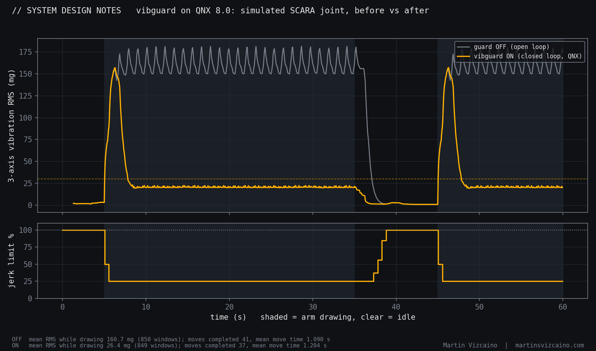
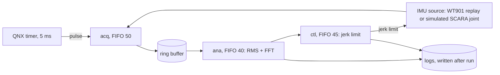
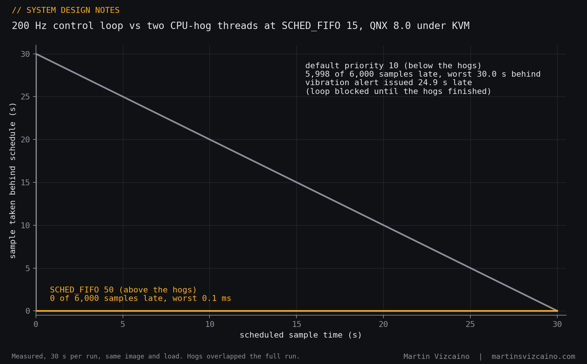

# vibguard: a real-time vibration guard for a SCARA robot on QNX 8.0

vibguard watches a robot arm's IMU at 200 Hz, detects vibration in real time, and closes the loop: when vibration crosses a threshold it lowers the jerk limit of the motion profile, then restores it once the arm settles. It is written in C on QNX 8.0 using QNX timers, pulses and priority scheduling, and it runs on a QNX 8.0 virtual machine built from scratch with `mkqnximage`.

Built for the QNX Global Hackathon 2026 (Robotics & Medical).



## Why

I research vibration suppression on a 6-DOF SCARA robot (ESP32, C++), using jerk-limited command shaping. That work happens offline: record IMU data, analyse it in MATLAB, change the motion profile, repeat. vibguard moves the loop onto a real-time OS so the robot can protect itself while it moves: measure, decide, and command a gentler profile within milliseconds, with timing guarantees that a general-purpose OS does not give.

## What it does

| Thread | Priority | Job |
|---|---|---|
| `acq` | SCHED_FIFO 50 | QNX timer delivers a pulse to a channel every 5 ms. Each tick takes one IMU sample (replayed from a recording, or from the simulated joint) into a lock-protected ring buffer and timestamps it. |
| `ctl` | SCHED_FIFO 45 | Closed loop with hysteresis. RMS above 30 mg halves the jerk limit (again every 0.5 s while high, floor 25 %). After 1 s below 10 mg it restores in x1.5 steps. The command output is simulated (logged with timestamps). |
| `ana` | SCHED_FIFO 40 | Every 10 samples (50 ms): 3-axis vibration RMS over a 256-sample (1.28 s) window, sqrt(var_x + var_y + var_z), and the FFT peak frequency of the dominant axis (Hann window, radix-2 FFT). |
| `main` | default | Console dashboard. Writes logs and timing statistics after the run. |

The real-time threads do no I/O. Everything is stored in preallocated arrays and written when the run ends, so logging cannot disturb the timing.



Measured per run: tick jitter, ticks later than 1.5x the period, analysis time, alert latency (acquisition of the newest sample to the jerk command), and how far analysis lags acquisition.

## Input data: what is real and what is simulated

- **Real sensor data.** Three recordings from my WitMotion WT901 IMU (`data/`), logged at about 200 Hz from MATLAB. The vibration bursts in them are me moving the sensor by hand during setup, not robot motion. They are used for replay testing and as the sensor-noise source for the simulation.
- **Simulated SCARA joint** (`-s`). I did not have access to the robot during the hackathon, so the closed-loop demo uses a physics model: a jerk-limited 7-segment move profile (peak accel 3 m/s^2, nominal jerk 150 m/s^3 = 100 %) drives a lightly damped flexible mode (12 Hz, damping ratio 0.03). The IMU reading is the residual acceleration (measured minus commanded) plus real sensor noise taken from a quiet stretch of the WT901 recording. A new jerk limit applies from the next move, as a trajectory planner would. Scenario: idle 0 to 5 s, drawing 5 to 35 s, idle 35 to 45 s, drawing 45 to 60 s.

## Results

All numbers below were measured by vibguard on QNX 8.0 in real time (200 Hz). The QNX target is an x86_64 VM running under QEMU emulation on an Apple Silicon Mac, so absolute timing there is limited by the emulator. The KVM section below reruns the same image with hardware virtualization.

### Closed loop: guard off vs guard on (simulated joint, 60 s each)

| | Guard off (open loop) | vibguard on | Change |
|---|---|---|---|
| Mean vibration RMS while drawing | 160.7 mg | 26.4 mg | -84 % |
| Mean move time | 1.090 s | 1.204 s | +10 % |
| Moves completed | 41 | 37 | |
| Alert latency (sample to jerk command) | | 0.53 to 0.70 ms | |

This is the same trade-off my research studies: a gentler profile costs a little cycle time and removes most of the vibration.

### Noisy neighbour: do priorities protect the 200 Hz loop? (KVM, 30 s each)

Two CPU-hog threads at SCHED_FIFO 15 spin on both of the VM's CPUs for the whole run (each summary prints the acquisition window next to each hog's start and end to prove the overlap). Results in `results/kvm_load/`.

| | L0: no load | L1: hogs, vibguard FIFO 50/45/40 | L2: hogs, vibguard default priority 10 | L3: hogs at FIFO 60, above vibguard |
|---|---|---|---|---|
| Samples more than 2.5 ms behind schedule | 0 of 6000 | 0 of 6000 | 5998 of 6000 | 5998 of 6000 |
| Worst sample behind schedule | 0.1 ms | 0.1 ms | 30.0 s | 30.0 s |
| Vibration alert issued after the sample's scheduled time | same as L0 | same as L0 | 24.9 s late | 23.4 s late |



With priorities above the load, the loop is untouched: tick jitter p99 was 52.1 us in L1. Below the load, the acquisition thread does not run at all until the hogs finish; the timer pulses queue up and are drained in one burst at the end. L3 is the control: the same starvation happens to the real-time configuration once something outranks it, which is exactly what strict priority scheduling predicts.

Two lessons from getting this test right:
- **My first version of the test was wrong.** vibguard's main thread runs at default priority and created the FIFO hogs before the control threads. The hogs took both CPUs, so main could not even start the control loop until they finished, and every "under load" run (on the emulated target and on KVM) actually ran with no load. A `pidin` sample showed the hogs already dead when the loop was running. The fix: start acquisition first, then the hogs, and print both time windows in every summary. The old load-test numbers were dropped.
- **Interval-based metrics hide stalls.** In L2 my original metric ("ticks later than 1.5x the period") reported 1 late tick, because one 30 s gap was followed by 5997 queued ticks back to back. vibguard now also measures each sample against its schedule and each alert against its sample's scheduled time.
- The closed-loop numbers in the simulation did not change under starvation, because the simulated plant advances per sample, not per wall-clock second. On a real robot, a 25 s late vibration alert is the failure.

### Timing: emulated VM vs KVM

The same QNX image and binaries, run two ways: QEMU emulation (TCG) on the Mac, and QEMU with KVM hardware virtualization on a Google Cloud n2-standard-4 VM with nested virtualization (2 vCPUs, 1 GB for QNX). Results from the KVM run are in `results/kvm/`.

| Measured | Emulated (TCG, Mac) | KVM (cloud) |
|---|---|---|
| timer200 jitter, FIFO 63 (median / p99 / max) | 363.1 / 1717.4 / 4680.5 us | 13.5 / 85.2 / 121.2 us |
| vibguard tick jitter, guard on 60 s (median / p99 / max) | 0.33 / 1.74 / 6.7 to 18.3 ms | 15.3 / 100.5 / 304.5 us |
| Ticks later than 7.5 ms, guard on 60 s | not recorded | 0 of 11999 |
| Analysis time, RMS + FFT on 256 samples (median / p99) | 0.33 / 0.56 ms | 12.5 / 41.6 us |
| Alert latency, sample to jerk command | 0.53 to 0.70 ms | 44 to 93 us |

Under emulation, 42.9 % of timer200 intervals were off by more than 10 %; under KVM, none were. Under KVM the 200 Hz loop holds its period to within about 0.1 ms at p99, and analysis plus control finish in tens of microseconds. The closed-loop outcome was identical on both (160.7 mg open loop vs 26.4 mg guarded), as expected for a deterministic simulation.

## Repository layout

```
src/vibguard.c          the application (QNX 8.0; also builds on Linux for logic tests)
src/timer200.c          200 Hz QNX timer test (pulse + MsgReceivePulse)
src/hello.c             hello world
data/                   WT901 IMU recordings (CSV)
results/                measured outputs, charts and summaries
docker/Dockerfile       x86_64 Linux build container for the QNX host tools
scripts/                build steps run inside the container, chart scripts
go.sh                   one-shot setup: QEMU, container, minimal QNX VM, hello + timer tests
run_vibguard.sh         build vibguard, run replay + guard off + guard on on the VM
run_loadtest.sh         noisy-neighbour test
go_arm.sh               aarch64 QNX VM (boots under emulation; see notes)
```

## Reproduce

Requirements: a free [QNX Everywhere](https://www.qnx.com/getqnx) non-commercial license, QNX SDP 8.0 with the QNX SDP Host Tools (Linux 64-bit) installed to `~/qnx800` through QNX Software Center, Docker Desktop and Homebrew. No QNX files are included in this repository.

On an Apple Silicon Mac (the setup I used):

```bash
bash go.sh            # QEMU, build container, minimal QNX VM, boot, hello + 200 Hz timer test
bash run_vibguard.sh  # build vibguard with qcc, run replay, guard off, guard on
bash run_loadtest.sh  # noisy-neighbour test
python3 scripts/plot_compare.py results/vibguard_runS0 results/vibguard_runS1 results/vibguard_before_after.png
```

QNX SDP 8.0 host tools are Linux x86_64 only, so on a Mac they run inside an x86_64 Docker container, following QNX's own macOS guide. On an x86_64 Linux host you can call `qcc` and `mkqnximage` directly and run QEMU with KVM.

Run it by hand on the QNX target:

```bash
./vibguard -s -c 1 -N data/wt901_20261005_121751.csv -n 12000 -o out   # simulated joint, guard on
./vibguard -s -c 0 -N data/wt901_20261005_121751.csv -n 12000 -o out   # guard off baseline
./vibguard -f data/wt901_20261005_121751.csv -n 8000 -o out            # replay a recording
./vibguard -s -l 2 -g 15 -o out                                         # with 2 CPU hogs
```

## Limitations and next steps

- The robot loop is simulated. The next step is the real SCARA robot: live WT901 input and a real jerk-limit command to the ESP32 motion controller.
- Timing numbers come from VMs (emulated, and KVM on a cloud host), not bare metal. A Raspberry Pi 5 or x86 board would be the next step.
- An aarch64 image boots under emulation, but not yet under Apple's hardware virtualization: QNX's `startup-qemu-virt` asserts in its GICv3 code under HVF, and QEMU's HVF backend has no GICv2.

## Author

Martin Vizcaino, University of Indianapolis. [martinsvizcaino.com](https://martinsvizcaino.com), [LinkedIn](https://www.linkedin.com/in/martinvizcaino), [GitHub](https://github.com/veldig)

QNX is a trademark of BlackBerry Limited. This is an independent hackathon project.
